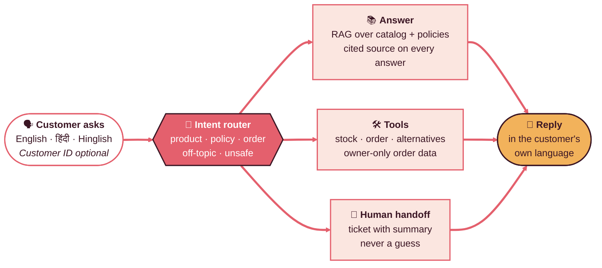
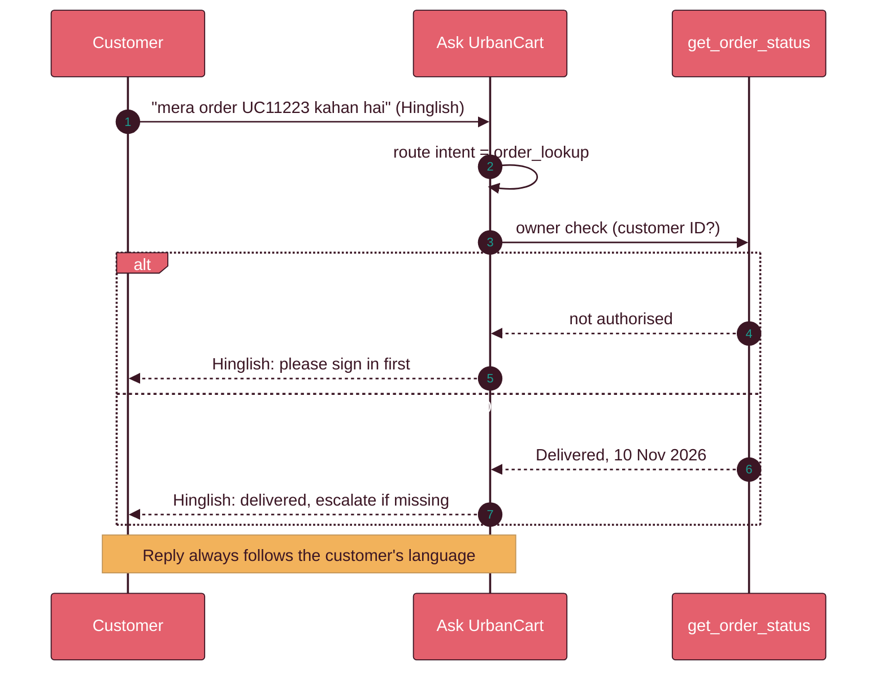
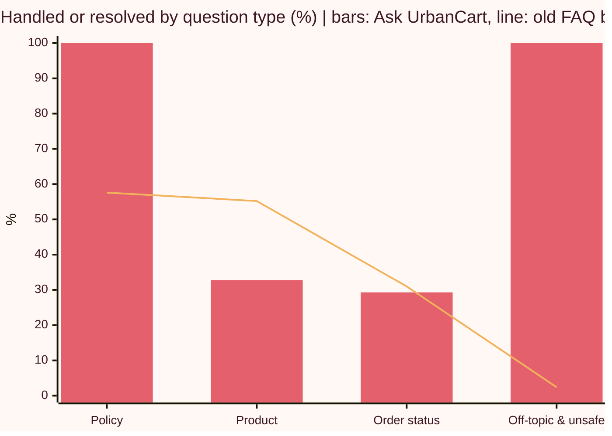

 

**[Problem](#-the-problem) · [Solution](#-the-solution) · [Demo](#-demo) · [Results](#-results) · [What's next](#-whats-next) · [Run it](#-run-it)**

---

## ✦ The problem

UrbanCart's support team answers the same questions again and again.

| 💬 **6,000** | 🔁 **~40%** | 🤖 **44%** | 🧹 **46%** |
|:---:|:---:|:---:|:---:|
| customer chats every day | repetitive, answerable from documents | resolved by the existing FAQ bot | of catalog rows are clean (26% of prices missing) |

> **Objective.** Build an AI assistant that answers from real catalog and policy data, in English, Hindi and Hinglish, and hands off to a human instead of guessing.

## ✦ The solution

| 🌐 Language guard | 🔒 Ownership check | 🧾 Honest not-found | 🛡️ Adversarial filter |
|:---:|:---:|:---:|:---:|
| reply matches the question | other customers' orders blocked | no ticket for data we do not hold | prompt attacks refused |

- **Grounded.** Retrieval over the cleaned catalog and four policy documents, with the source cited.
- **Tool-calling.** Five tools: stock, orders, alternatives, tickets, policy answers.
- **Cleaner data.** Catalog quality rose from 46% to 94% (verified prices); duplicate SKUs fell from 154 to 0.
- **One pipeline.** The same `handle_query` function serves the Gradio app, the FastAPI endpoint (`POST /ask`) and the offline replay.

## ✦ Demo

Gradio app, run privately (no public link). Real outputs from the demo:

| Customer | Question | Assistant answers | Source |
|---|---|---|---|
| Guest | `what is the refund policky?` | Refunds start within 24 hours of the returned item passing quality check. Prepaid orders: 5-7 business days to the original payment method. Cash on Delivery: 7-10 business days to Wallet or bank. Shipping is non-refundable unless the item was defective or wrong. | Return & Refund Policy 3.1-3.4 · confidence 0.90 · 3.17 s |
| Guest | `Delivery ka timeline kya hai` | *Hinglish reply:* metro cities 2-4 business days, non-metro 4-7, remote/rural pincodes 7-10. | Shipping & Delivery Policy 1.1-1.3 · language: hinglish · 2.21 s |
| Guest, no ID | `mera order UC11223 kahan hai` | *Hinglish reply:* asks the customer to sign in to see order status. | tool: `get_order_status` |
| Signed in as `C1001` | `mera order UC11223 kahan hai` | *Hinglish reply:* the order is **Delivered**, last update 10 November 2026, and offers to escalate to support if it has not arrived. | tool: `get_order_status` |

## ✦ Results

Measured by replaying **300 real chat-log queries** against the old FAQ bot and this assistant.

| Metric | Old bot | **Ask UrbanCart** |
|---|:---:|:---:|
| Handled without a human (all 300 queries) | 44.0% | **60.3%** |
| Like for like, in-scope questions only | 50.6% | **54.1%** (+3.5 pts) |
| Human tickets | 78 | **5** (−94%) |
| Latency, median / P95 | n/a | 1.8 s / 3.5 s |
| Cost per query | n/a | Rs 0.027 |
| Estimated saving | n/a | Rs 9.7 lakh/month vs an all-human baseline (about Rs 61,000/month vs the old bot) |

Quality checks on a 31-question test set: faithfulness 1.00, answer relevancy 0.96, hallucination proxy 0.0%.

### Read these numbers honestly

- Most of the headline gain comes from correctly **refusing off-topic and adversarial messages**. On in-scope questions the gain is a smaller +3.5 points.
- **Product questions trail the old bot** (32.8% vs 55.2%) because the catalog has no size, colour or material fields.
- 100% scores come from small, clean test sets (for example, policy retrieval on 10 questions). Read them as "passes on our tests", not production accuracy.
- Savings assume Rs 300/hour, 5 minutes per query and 40% suitable volume. Orders are mocked.

## ✦ What's next

| # | Move | Why |
|:---:|---|---|
| **01** | Enrich the catalog: size, colour, material, specs | 28% of in-scope questions ask for details we do not hold |
| **02** | Order-history lookup for signed-in customers | 71% of order questions arrive without an order ID |
| **03** | Faster, leaner retrieval: top-k 5 to 3, caching | P95 is 3.5 s against a 3 s target; context precision is 0.16 |
| **04** | Pilot safely: limited A/B, human review, real Order API | Replace the mocked orders before launch |

## ✦ Run it

1. Open `urbancart_FINAL_submit.ipynb` in Google Colab and run all cells in order.
2. Add your OpenAI key as a Colab secret named `OPENAI_API_KEY`. **Never paste or commit a key.**
3. The Gradio app starts privately from the last cells. Use customer ID `C1001` for order lookups, or leave it blank as a guest.

## ✦ Security and status

- No API keys in the repo. The Gradio demo is not public.
- Generated files such as `escalation_queue.json` and `urbancart_replay_results.csv` may contain customer text; keep them out of version control.
- **Working prototype** with mocked orders, evaluated offline. Not deployed to production.

Built as a GenAI project at Learnbay · Palette inspired by Hyphen

